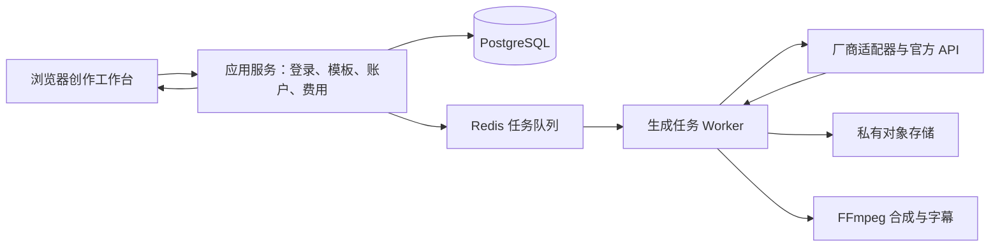

# 个人 AIGC 音视频创作网站：产品方案与预算

核验日期：2026-10-24。目标目录：`D:/code/AIGC/`，本次仅提供方案，尚未编写网站业务代码。

定位：一个自带各厂商 API Key 的个人创作工作台，统一管理生成任务、提示词模板、素材、账户和成本。默认单人使用、私有部署，结构保留扩展到小团队的空间。

本文是产品与架构方案；工期和人工价格是规划估值，实际接入权限、套餐、地区和账单以厂商为准。

## 1. 产品范围与页面

| 页面 | 核心功能 |
| --- | --- |
| 工作台 | 最近项目、进行中任务、常用模板、当月花费、账户余额与异常 |
| 视频创作 | 文生视频、图生视频、首尾帧、多素材参考；按所选模型显示可用参数 |
| 音频创作 | 配音、多角色台词、音乐、音效；试听、字幕及音视频合成 |
| 提示词库 | 分类树、标签、搜索、增删改查、变量模板、版本、历史效果与一键套用 |
| 项目与素材 | 项目分组、图片/音频/视频上传、生成历史、筛选、下载、归档 |
| 模型与账户 | 厂商卡片、Key 绑定、连接测试、模型权限、余额查询、充值入口 |
| 费用中心 | 预估费用、实际费用、待核对费用；按项目、模型、账户和时间统计 |
| 设置 | 登录、预算、素材保留期限、备份和基础配置 |

主要操作路径：选模板 → 填变量 → 选模型与参考素材 → 查看费用 → 提交 → 查看进度与结果 → 评分/收藏 → 将成功结果保存为模板案例。

视频页建议三栏：左侧提示词与素材，中间参数和预估价格，右侧结果播放器与历史。页面只展示当前模型支持的时长、分辨率、参考方式和音轨选项。

音视频合成第一版支持片段排序、旁白、背景音乐、音量、字幕和 MP4 导出；复杂时间线剪辑放在后续版本。

## 2. 当前模型清单与接入原则

优先覆盖有明确 API 或可核验服务渠道的主流前沿模型。模型品牌、实际渠道、地区与模型版本分别保存；同一模型的厂商直连价和平台渠道价不可混用。

### 2.1 视频模型及单次估价

以下为单次成功生成的基础费用示例，通常按 10 秒、无参考视频估算，不包含反复挑片、额外素材、超分、存储、网络和税费。人民币折算统一使用**预算假设 1 USD = 7.2 CNY**，不是实时汇率。

| 模型 | 接入渠道与规格 | 基础单价/口径 | 10 秒估价 | 建议用途与状态 |
| --- | --- | --- | --- | --- |
| Seedance 2.5 | 火山方舟；720p、16:9、24fps、无视频输入 | ¥70/百万视频 token；官方 5 秒示例 ¥7.56 | 约 ¥15.12 | 前沿创作主力候选 |
| Seedance 2.5 | 同上，1080p | ¥77/百万视频 token；官方 5 秒示例 ¥18.71 | 约 ¥37.42 | 高规格精修 |
| Seedance 2.0 Mini | 火山方舟；720p、16:9、无视频输入 | 官方 5 秒示例 ¥2.48 | 约 ¥4.97 | 低成本草稿 |
| Wan 3.0 | 阿里云百炼北京；720p | 原价 ¥0.60/秒，目前限时七折约 ¥0.42/秒 | 约 ¥4.20，原价 ¥6 | 国内日常创作候选 |
| Wan 3.0 Prime | 同上；720p | ¥0.90/秒 | ¥9 | 高质量候选 |
| MiniMax H3 / H3 Lite | MiniMax 国内平台；768p | ¥0.50 / ¥0.26 每输出秒 | ¥5 / ¥2.60 | 多素材创作、草稿分档 |
| Vidu Q4 Preview | Vidu 当前人民币价目；720p / 1080p | 19 / 24 积分每秒，¥0.03125/积分 | ¥5.94 / ¥7.50 | 前沿预览版，单独开关 |
| Kling 4.0 | **经 Runway Dev 渠道**；720p / 1080p、无视频输入 | 促销 $0.1256 / $0.188 每秒 | 约 ¥9.04 / ¥13.54 | 前沿候选；须实测账户权限 |
| Kling 3.0 Standard / Pro | **经 Runway Dev 渠道**；含音轨 | $0.13 / $0.17 每秒 | 约 ¥9.36 / ¥12.24 | 可作为稳定兼容档 |
| Runway Gen-4.5 | Runway Dev；基础输出格式 | $0.12/秒 | 约 ¥8.64 | 海外创作候选 |
| Gemini Omni Flash 1.1 | Gemini API；720p 视频输出部分 | $17.50/百万视频 token，约 $0.10/秒 | 输出部分约 ¥7.20 | Google 当前视频主力候选 |
| Grok Imagine Video 1.5 | xAI API；720p | $0.14/秒 | 约 ¥10.08 | 参考素材与音画创作候选 |
| Grok Imagine Video 1.5 Lite | xAI API；720p | $0.03/秒 | 约 ¥2.16 | 海外低价草稿候选 |

来源与关键口径：

- [火山方舟模型价格](https://docs.volcengine.com/docs/ark/model-pricing?lang=zh)：Seedance 按视频 token 结算；有视频输入还涉及参考时长和最低 token 用量。上述 10 秒价格由官方典型规格示例推算，实际取 usage。火山 LAS 算子是另一套渠道价，不能套入方舟。
- [阿里云模型价格](https://help.aliyun.com/zh/model-studio/model-pricing)：Wan 3.0 的输入视频和输出视频均计费；限时折扣的结束时间、可用地域和权限应在接入时复核。
- [MiniMax 定价](https://platform.minimax.cn/docs/pricing/overview)：H3 参考视频另计输入费用，超出免费张数的图片另收费；表中仅列输出基础价。
- [Vidu 定价](https://platform.vidu.com/docs/overview/pricing)：Q4 为 Preview；当前人民币充值表最低列出 ¥500 档。消费成本和首次充值金额要分开显示。
- [Runway Dev 价格](https://dev.runwayml.com/pricing)：Kling 4.0 当前活动至 2026-11-30，720p / 1080p 非活动单价分别 $0.157 / $0.235 每秒；视频输入有额外计量规则。这里是 Runway 的渠道报价，不是可灵直连报价。Gen-4.5 的特殊输出格式可能加价。
- [Google 定价](https://ai.google.dev/gemini-api/docs/pricing)：Omni 表中费用仅为视频输出部分，还要累计输入和其他输出 token。
- [xAI 定价](https://docs.x.ai/developers/pricing)：参考图片等输入可能另外计费。

这些价格只用于规划与界面价格表初始化；接通账户后应验证模型 ID、权限、计量字段、最低时长和价格规则，再开放实际生成。

### 2.2 配音、音乐、音效与字幕

| 能力 | 首选候选 | 当前价格示例 | 说明 |
| --- | --- | --- | --- |
| 中文配音 | MiniMax speech-2.8-turbo / hd | ¥2 / ¥3.5 每万**计费字符** | 该平台 1 个汉字算 2 个字符；1 万汉字纯文本约 ¥4 / ¥7，标点等另累计 |
| 多语言与表演配音 | Eleven v4 / v4 Turbo | $0.08 / $0.04 每千字符 | 按 ElevenAPI 价目，音色或账户条件需实测 |
| Google 配音 | Gemini 3.8 Flash TTS | 当前音频输出约 $0.00225/10 秒 | 另算文本输入；活动价至 2026-12-31，2027 年相应标准价提高 |
| 音乐 | Lyria 3.5 | $0.08/首，预算折算约 ¥0.58 | 以请求及账户可用能力为准 |
| 音效 | Vidu audio1.0 | 10 秒以内 20 积分，约 ¥0.625 | 预留 ElevenLabs 音效适配器，实际接入另核价格 |
| 字幕转写 | MiniMax ASR / Eleven Scribe v2 | ¥2.50/小时 / $0.22/小时 | 作为字幕与配音工作流的辅助能力 |

来源：[MiniMax](https://platform.minimax.cn/docs/pricing/overview)、[ElevenAPI](https://elevenlabs.io/pricing/api)、[Google](https://ai.google.dev/gemini-api/docs/pricing)、[Vidu](https://platform.vidu.com/docs/overview/pricing)。

### 2.3 生命周期与待接入项

- Sora 2 / Sora 2 Pro 和 Videos API 已列明于 2026-09-24 关闭，保留历史展示能力，不列为当前可用生成入口。[OpenAI 官方停服公告](https://developers.openai.com/api/docs/deprecations)
- Gemini API 的 Veo 3.1 Preview 系列已进入停服窗口，官方列出的最早日期是 2026-10-22，并推荐 Omni 1.1 Flash。不能仅凭最早日期推断所有渠道均已停服；Google 直连接入优先 Omni，Veo 另按实际渠道实测。[Google 生命周期](https://ai.google.dev/gemini-api/docs/deprecations)
- MiniMax 音乐付费接口自 2026-08-20 起不向新用户提供，历史付费用户存在延续服务说明；不能给新账户默认启用。[MiniMax 说明](https://platform.minimax.cn/docs/pricing/overview)
- Luma 等模型保留适配位置；确认当前 API 开放、价格及账户权限后再启用。网页产品可用不能直接推断 API 可用。
- 新模型状态统一分为：已验证、预览、待授权、待核验、停用。模型目录记录官方链接、核验日期、停服日期和替代模型。

## 3. 可视化 Key 绑定与账户页

使用“厂商卡片列表 + 账户配置侧栏”。一家公司可绑定多个账户；同一账户下多个 Key 可以共用一个计费账户记录，避免重复汇总余额。

卡片字段：厂商、账户别名、地区、渠道、Key 尾号、连接状态、可用模型数、余额/积分、余额来源、统计时间、当月用量、预算上限、低余额阈值。

操作按钮：**绑定 Key、测试连接、查询余额、查看费用、前往充值、编辑、更换 Key、停用、删除绑定**。

绑定流程：

1. 选厂商、地区和接入渠道。
2. 填写对应凭据；通用 API Key 和 AK/SK 两种鉴权分别支持，按接口实际需要显示。
3. 如要查云账户余额，单独绑定具备账单只读权限的身份；不假设模型推理 Key 也能查账。
4. 执行不产生生成费用的认证/能力检查；若厂商只提供付费测试，按钮明确标出估价。
5. 选择启用模型，设置账户预算，保存。

Key 经 HTTPS 提交后在服务器加密保存，密文主密钥与数据库分离。浏览器只得到尾号和状态；请求日志、错误、导出、备份与代码仓库不得携带 Key 明文。单人版同样需要登录。

### 3.1 “查询余额”真实支持情况

| 厂商/渠道 | 查询能力 | 页面应如何显示 |
| --- | --- | --- |
| Runway Dev | `GET /v1/organization` 返回 creditBalance | 官方 API 积分，按该账户渠道解释；不与网页订阅积分混用 |
| Vidu | `GET /ent/v2/credits` | 分资源包展示剩余积分、并发与到期信息 |
| 可灵官方 | `GET /account/costs` 可查询资源包余量 | 标明官方提示的约 12 小时统计延迟；不写“实时现金余额” |
| ElevenLabs | `GET /v1/user/subscription` | 展示周期额度、已用量、重置时间；字符额度不等同现金余额 |
| 阿里云 | `QueryAccountBalance` | 云账户现金/可用额度；需要单独的云账单身份与权限 |
| 火山引擎 | `QueryBalanceAcct` | 云账户余额；需要单独的云账单身份与权限 |
| Gemini API | 本次未确认可用普通推理 Key 直接查预付余额的公开接口 | 提供“打开官方账单”，显示本站用量与预算；不冒充官方余额 |
| MiniMax、xAI 等 | 余额接口及具体授权在接入阶段进一步核验 | 先提供官方账单入口和明确标注的本站估算 |

接口依据：[Runway](https://docs.dev.runwayml.com/api/)、[Vidu](https://platform.vidu.com/docs/api-reference/task-management/account-balance)、[可灵](https://kling.ai/document-api/api/assets/account-usage)、[ElevenLabs](https://elevenlabs.io/docs/api-reference/user/subscription/get)、[阿里云](https://help.aliyun.com/en/user-center/developer-reference/api-queryaccountbalance)、[火山引擎](https://api.volcengine.com/api-docs/?serviceCode=billing&version=2022-01-01)、[Gemini 账单](https://ai.google.dev/gemini-api/docs/billing)。

余额统一记录来源类型：官方余额、官方资源额度、官方周期配额、人工录入、本站估算、不可用。每项显示币种/单位、更新时间、延迟提示。查询失败显示“查询失败/旧数据”，不显示为 0。

“批量刷新”按厂商限流执行，并用缓存避免频繁点击。本站预算只能控制本站提交的任务，不能限制其他客户端使用同一账户产生的消费。

## 4. 提示词资产库

提示词库是独立核心模块。模板、模板版本与每次生成时的实际提示词分别保存。

### 4.1 分类体系

采用“可自定义三级分类树 + 多维标签”。树用于稳定归档，标签用于交叉筛选，避免为每个模型复制一整套分类。

| 一级分类 | 二级分类示例 | 三级分类示例 |
| --- | --- | --- |
| 视频 | 电商与广告 | 商品展示、开箱、卖点特写、场景植入 |
| 视频 | 叙事与短剧 | 人物出场、对白、转场、动作、结尾 |
| 视频 | 视觉风格 | 写实、动画、国风、水墨、赛博、纪录片 |
| 视频 | 镜头与运动 | 推拉摇移、环绕、航拍、微距、固定镜头 |
| 音频 | 配音 | 电商口播、知识讲解、有声书、人物对白 |
| 音频 | 音乐 | 广告配乐、氛围、片头片尾、歌曲 |
| 音频 | 音效 | 环境、人群、机械、动作、转场 |
| 工作流 | 成片模板 | 产品广告、知识短片、短剧片段、音乐 MV |

附加标签：行业、主体、场景、风格、镜头、情绪、语言、声音、横竖屏、适用模型、难度、用途。支持交集筛选，例如“视频 + 电商 + 美妆 + 写实 + 微距 + 9:16”。

分类也支持增删改查、排序、合并和移动。删除含模板的分类时应先迁移模板或归入“未分类”；删除模板默认进入回收站。

### 4.2 模板数据与操作

每个模板保存：名称、说明、正向提示词、可选负向提示词、分类、标签、变量定义、模型专用版本、推荐参数、参考素材、封面、示例音视频、收藏、评分、使用次数、创建/修改时间。

支持：新增、编辑、复制、搜索、删除/恢复、版本对比/回滚、批量标签、JSON/CSV 导入导出、历史任务保存为模板、从模板查看实际效果。

模板示例：

```text
为 {{产品名称}} 制作一段 {{时长}} 秒的 {{画幅}} 广告。
主体置于 {{场景}}，采用 {{光线}} 和 {{视觉风格}}。
镜头从 {{起始景别}} 开始，以 {{运镜方式}} 展示 {{核心卖点}}。
保持产品形状、材质和标识一致。声音要求：{{声音描述}}。
```

变量定义包含类型、默认值、是否必填、选项和长度限制。点“套用”后生成表单，填写变量并预览最终文本；生成后保存的是本次副本，不直接覆盖原模板。

每次生成冻结模板版本、最终提示词、参数、模型、渠道、参考素材、任务 ID 和价格版本。模型不支持负向提示词等参数时，界面明确提示，不能悄悄丢弃。参考素材关联失效时先要求替换。

## 5. 费用系统

费用中心同时展示三类数：**提交前预估、任务完成后的实际/用量估算、官方账单核对结果**。用量乘价目得到的金额标记为“按用量估算”，不能直接当成官方扣款。

每条价格规则保存厂商、渠道、地区、模型版本、能力、分辨率、音轨、输入类型、计费单位、最低消费、有效期、折扣、官方来源和核验日期。价格变更只影响新任务，历史任务保留原快照。

费用计算累计：输出 + 参考图片/视频/音频 + 文本处理 + 可选音色/转写/超分/合成 + 存储与网络。无法可靠估算的计费项明确列为未知或区间。

成本控制：单次、单日、单月预算；提交前按账户原子预留本站预算，完成后按实际用量修正；金额超限阻止新提交。批量比较模型先展示总价。自动重试有次数和费用上限，超时先查询原任务，避免重复扣费。无法确认扣费的任务进入“待核对”，不能自动按零结算。

建议页面展示“本次预计 ¥4.20；本批预计 ¥12.60；重试最多 0 次；本月本站预算余量 ¥800”。高规格和多模型对比由用户主动选择。

### 5.1 月预算示例

假设每条最终选中的视频长 10 秒，平均每条需要生成 3 次；下表的数量是**最终采用条数**，生成尝试次数已计入，不再重复加一个三倍系数。

| 场景 | 视频假设与费用 | 配音/音乐假设与费用 | 基础设施规划值 | 预计总额 |
| --- | --- | --- | --- | --- |
| 个人日常 | 100 条，Wan 3.0 720p 当前 ¥0.42/秒：100×3×10×0.42=¥1,260 | 10 万汉字 MiniMax Turbo 约 ¥40；100 首 Lyria 约 ¥57.60 | ¥200/月 | 约 ¥1,558/月，建议预算 ¥1,600–2,000 |
| 同量按非活动价 | 视频按 ¥0.60/秒：¥1,800 | 同上 ¥97.60 | ¥200/月 | 约 ¥2,098/月，建议预算 ¥2,100–2,500 |
| 同量全用 Seedance 2.5 | 720p、无视频输入约 ¥1.512/秒：¥4,536 | 同上 ¥97.60 | ¥200/月 | 约 ¥4,834/月，建议预算 ¥5,000–6,000 |
| 小团队日常 | 1,000 条，同样三次尝试，Wan 当前价格：¥12,600 | 100 万汉字配音约 ¥400；1,000 首音乐约 ¥576 | ¥500/月 | 约 ¥14,076/月，建议预算 ¥14,000–17,000 |

以上都假设不带收费参考视频，且没有额外超分等付费步骤。最终成片的时长、挑片次数与使用高级模型的比例，是主要成本变量。

个人云部署的基础设施可先按 ¥100–500/月规划；这是工程预算，不是厂商套餐报价。包含应用、数据库、队列、少量对象存储和网络的预留；素材保留量、播放下载流量、备份会改变支出。本机部署可降低现金成本，但占用本机资源。

充值余额是预付款，不等同当月消费，也不等同网站维护费；消费者网站会员与开发者 API 权益需逐家确认。

## 6. 建议架构

默认采用一个代码仓库、模块化服务和独立任务进程，不需要自购 GPU。



- 前端与应用接口：Next.js + TypeScript，中文界面，组件库采用 shadcn/ui + Tailwind。
- 数据：PostgreSQL；第一版用全文搜索、分类和标签查询，后续按需要增加语义检索。
- 队列：Redis + BullMQ；按厂商账户限制并发，支持重启恢复和任务去重。
- 资源：本机目录或 S3 兼容对象存储；上传和播放使用签名访问，长期结果及时转存，避免临时下载链接过期。
- 合成：独立 FFmpeg 进程；字幕、旁白、混音、拼接放到后台。
- 状态更新：服务端事件推送 + 必要轮询；根据厂商能力使用回调并验证签名。
- 部署：本机开发，Docker Compose 管理云端应用、Worker、数据库与 Redis；正式版本设置 HTTPS、备份和恢复。

如果主要使用国内接口，优先选择国内网络条件适合的部署；海外模型按服务支持地区、账户资格和连通性选择正规渠道。适配器允许厂商直连和渠道共存，但不静默替换厂商、价格或数据发送地区。

### 6.1 数据边界

核心记录：用户、项目、厂商、计费账户、加密凭据、模型/渠道、能力配置、价格版本、余额快照、分类、标签、模板、模板版本、素材、任务、生成尝试、用量和费用明细。

任务状态：排队、已提交、生成中、成功、失败、取消申请中、已取消、状态未知。不是每个厂商都支持取消，已提交的取消不保证返还费用，按实际接口呈现。

适配器统一负责：认证检查、能力读取、提交任务、查任务、取消能力、余额能力、用量解析和结果下载。各厂商专用参数保留原字段，避免通用接口把重要能力抹平。

建议代码组织：

```text
D:/code/AIGC/
  apps/web/                  创作界面与应用 API
  apps/worker/               调度、下载、字幕和合成
  packages/providers/        各厂商适配器
  packages/pricing/          价格匹配、预估和对账
  packages/prompts/          模板变量、分类与版本
  packages/db/               数据结构与迁移
  tests/integration/         接口契约、费用与任务恢复检查
  infra/                     部署与备份配置
```

这是建议目录，后续开发开始前再确定具体接口与文件。

## 7. 分阶段交付与人工估值

| 阶段 | 交付范围 | 估计工作量 |
| --- | --- | --- |
| 第一阶段 | 页面结构、登录、数据层、账户/Key 页、提示词完整 CRUD/分类/标签/变量/版本 | 5–8 人日 |
| 第二阶段 | 火山、百炼、MiniMax、Runway 四条渠道；生成任务、素材历史、余额能力、费用预估和预算 | 10–15 人日 |
| 第三阶段 | 账户实测、错误恢复、备份、界面和部署验证 | 5–7 人日 |
| 扩展阶段 | Vidu、Google、ElevenLabs、xAI、可灵直连；多模型对比、音乐音效、成片合成 | 额外 10–20 人日 |

第一版约 20–30 人日；包含扩展能力约 30–50 人日，单人全职约 6–10 个工作周。厂商授权、审核、账号付款、接口变更与复杂剪辑会影响周期。这是范围估算，不是固定交付承诺。

若按 ¥1,200–2,000/人日作外包人工测算：第一版约 ¥2.4万–6万，扩展完整版本约 ¥3.6万–10万。自行开发时主要现金支出是 API 和基础设施；这些人工数值不是本次对话的收费。

第一版建议用 **Wan 3.0 / H3 Lite 做低价尝试，Seedance 2.5 做重点镜头，Runway 提供海外创作与部分渠道能力**；账户页和提示词库同时作为正式功能交付。Vidu Q4 Preview 与 Kling 4.0 的权限、计量和稳定性完成实测后再开放为常规选项。

## 8. 验收标准

1. 新建模板、三级分类和多维标签，搜索后套用，变量生成正确；编辑模板不改变历史任务的提示词快照。
2. Key 保存后客户端和日志无明文；测试连接、停用和更换凭据可用。
3. 至少完成四条首发渠道的真实小额生成验证；展示实际 task ID、返回用量、结果和失败原因。
4. 每个“查询余额”按钮有真实数据来源、单位与时间；不支持时有明确状态和官方账单入口。
5. 生成前有可解释估价；并发任务不会绕过本站预算；任务超时不重复提交。
6. 关闭网页或重启 Worker 后任务能继续恢复；结果能播放、下载并追溯模板版本。
7. 价格、活动到期、模型停服和渠道差异可配置；历史账单保持原口径。
8. 实际扣费无法核对时明确标为待核对；网站内消费不冒充整个厂商账户消费。

建议起步投入：本机或小型云服务器、四家首发渠道账号，以及约 ¥500–1,500 的小额联调预算；厂商最低充值要求可能使首次现金支出更高。按上述 100 条/月的日常场景，持续使用预算可先设为 ¥2,000/月并执行本站限额。
